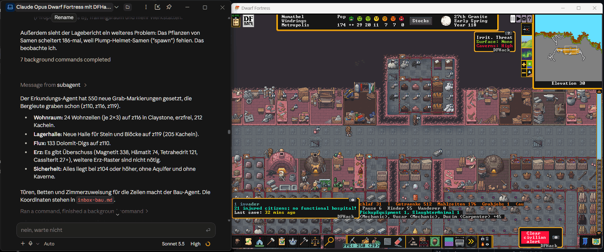

# dfpilot

An in-game kernel for Dwarf Fortress + DFHack that defends and supplies the fort by itself, so an LLM agent (Claude Code or similar) only plans the year and handles exceptions.

## Quick start

You need Dwarf Fortress 53.x from Steam with DFHack, Git, Python 3.11+ and an LLM agent that runs shell commands on the same Windows PC. Close DF, start the agent (best inside the cloned folder, so the fair-play hook in `.claude/settings.json` applies) and paste:

```text
Play Dwarf Fortress for me with dfpilot. DF 53.x (Steam) + DFHack are installed on this Windows PC.
1. git clone https://github.com/GordonMohrin/df-llm-helper, work in that folder, read RULES.md and follow it.
2. Find my DF folder (it has hack/dfhack-run.exe) and set DFLLM_DF to it. With DF closed run
   python tools/migrate_v2.py (dry run), then python tools/migrate_v2.py --apply.
3. Ask me to start DF through DFHack and to load or embark a fort. In it run dfllm adopt, then dfllm selftest full
   (via dfhack-run).
4. Keep python -m dfpilot follow running as your watcher. Make the year plan (plan propose, check, apply)
   and react to its wake lines as RULES.md says. Fair play only; report briefly; ask me only for real decisions.
```

Step-by-step notes and troubleshooting: [docs/v2/QUICKSTART.md](docs/v2/QUICKSTART.md).

## What it does

A Lua kernel runs inside DFHack on every frame. It watches the fort, raises the bridges when invaders show up, keeps food and drink above their targets, builds the approved plan from blueprint templates and writes everything it knows into files. The Python side only reads those files and turns the few events that need judgement into one short wake line for the LLM. The LLM answers with a year plan or one command from a closed set; it never steers tactics.

```
Dwarf Fortress 53.x + DFHack
├─ DFHack natives, set up by `baseline`: buildingplan, suspendmanager, labormanager (monitor), autochop,
│  autofarm, autobutcher, tailor, logistics, burial/preserve-tombs, pop-control, timestream, orders library ...
└─ lua/dfllm kernel: ONE frame dispatcher + 20 modules, budget 25 ms per real second
     SENSE   sense, snapshot        visible units and revealed tiles only
     DECIDE  reflex, siege, threat, gate, seal, military, drill, readiness, runner, economy, care, water, traps, trade, baseline
     ACT     arbiter (pause, tempo) + act.lua, the only writer; every act function is a UI action
     CHECK   perf, selftest         ticks/s and frame gaps; the in-game self-test
     IO      <DF>/dfllm-runtime/<save>/  state.a|b.json, events.jsonl, inbox/ -> outbox/, snap/, perf.csv
                 │ files only (0 DF calls)                       ▲ inbox: closed verb set
                 ▼                                               │
Python dfpilot (stdlib): follow · status · brief · plan · cmd · bp (templates, path audit, sites) · doctor · lint
                 │ one wake line (<= 150 tokens) per class-A event  ▲ year plan, one command per wake
                 ▼                                               │
LLM agent (Claude Code, ...): year planner and exception handler, never a tactical controller
```

What the kernel does without the LLM:
- **Siege reflex** in the game step that first sees visible invaders: siege mode, civilian alert, squads to their stations, bridges up as soon as nobody is outside; a sealed fallback (BREACH) if a bridge is not up after 900 ticks.
- **Supply:** stock days for food and drink, brewing, meals, barrels, farms and fishers sized to the population, manager orders, tool details (miners, woodcutters, hunters).
- **Building:** a project runner digs, builds and zones template blueprints (fortress core with drawbridges, levers, killing field and refuge; dining, bedrooms, tombs, hospital, temple, tavern, workshops, farms, furnaces, office, captives, cistern, stockroom, refuge_beds, refuge_drink; the defense add-ons gallery_o1 and seal). The fort advances through phases P0-P7 from `plans/year1.json`.
- **Care:** strange moods (materials, reserves), burials, corpses, ghosts, thirsty patients, stress and clothing.
- **Readiness gate:** the population cap (55) rises only after a worst-case path audit and a passed drill.
- **Trade:** a caravan state machine (broker job, goods from `dfllm-trade` stockpiles, ratio check).

## Why v2

v1 drove the game from outside: a Python watcher called `dfhack-run` every 2 s, and the LLM checked in every few minutes. That blinded itself (each call suspends DF's main thread) and reacted too late. v2 moves every reaction into the game and keeps the LLM for the year plan.

| | v1 (Run 6, measured) | v2 (live slots L1b-L5, measured) |
|---|---|---|
| Game speed in peace | median 197 ticks/s (deciles 77-256) | median 398-453 ticks/s per slot (target 450) |
| Cost inside DF | never timed; 39 Lua jobs, about 30 full item scans per minute | kernel median 16-22 ms per real second (L1b-L4), p90 25-29; L5 up to 74 during audit exports |
| Main-thread stalls | about 2,000 calls over 3 s, up to 85 s | 0 frame gaps over 3 s outside the yearly autosave (6.3 s) |
| `dfhack-run` spawns per hour | about 4,300 | **0** (Python reads files) |
| LLM input tokens per hour | about 74 M (about 0.5 M per main turn) | about 0.6 M (L3, a full engineering session incl. code fixes); budget 3 M |
| Reaction to invaders | at the next LLM check; siege start 30 s after arrival, the first enemy needed 22 s | in game, in the same tick that the threat scan (every 10-50 ticks) sees them; no LLM in the loop |

Sources: `docs/v2/ASIS-ANALYSIS.md` (v1) and the KPI tables in `docs/v2/STATUS.md` §0-§0f (v2). The v1 code stays in the tag `v1-final`; what left and which v1 lessons still hold: `docs/v2/V1-LEGACY.md`. The reflex timing is tested offline and seen live in drills and two false alarms; no real siege has hit the test fort yet (see Status).



<sub>v1, Run 5 "Windrings" (DF 53.16 + DFHack): Claude as orchestrator with sub-agents; the fort grew to 174 citizens and later fell. v2 is the rewrite after that run; it has no screenshot of its own yet.</sub>

## Requirements

- Dwarf Fortress 53.x from Steam with DFHack, started through DFHack. Tested: DF 53.16 + DFHack 53.16-r2.
- Windows (tested on Windows 11). `tools/migrate_v2.py` and `tools/win/*.ps1` use Windows tools; the Python CLI itself is portable but untested elsewhere.
- Python 3.11+, standard library only. Git. `pytest` only for the tests. The hook runs under `bash` (Git Bash on Windows).
- An LLM agent with shell access on the same PC. It is built for Claude Code (the `Monitor` tool on `follow`, subagents per wake line, the PreToolUse hook); others work if they can keep `follow` running and read its lines.

## Manual install

1. `git clone https://github.com/GordonMohrin/df-llm-helper dfpilot && cd dfpilot`
2. Set `DFLLM_DF` to your DF folder (the one with `Dwarf Fortress.exe` and `hack/dfhack-run.exe`). Without it the tools fall back to the author's Steam path. `python -m dfpilot` and `tools/migrate_v2.py` also take `--df <folder>` (for `dfpilot` before the command name: `python -m dfpilot --df <folder> status`); `tools/embark/embark.py` and `tools/luahost.py` read only `DFLLM_DF`.
3. Close DF, then run `python tools/migrate_v2.py` (dry run: prints every step) and `python tools/migrate_v2.py --apply`:
   - `dfhack-config/script-paths.txt` gets `+<clone>\lua` (DF reads it only at startup);
   - `dfhack-config/init/onMapLoad.init` then runs only `dfllm boot`; the old file is copied to `<DF>/_archive-v1/migrate_v2/` first, so copy any lines of your own back by hand;
   - v1 leftovers (old scripts, runtime folder, scheduled task) are moved or disabled if found; nothing is deleted, prefs files are not touched;
   - `python tools/migrate_v2.py --revert` undoes it.
4. Offline check: `python -m dfpilot lint` prints `0 finding(s)`.
5. Start DF through DFHack. `"<DF>/hack/dfhack-run.exe" dfllm selftest --mock` reports `0 fail`.
6. Load or embark a fort, then once: `dfhack-run dfllm adopt`. This writes the `dfllm` marker into the save, loads the phases of `plans/year1.json` and boots the 20 modules. Check `dfhack-run dfllm status` (no module `DISABLED`) and `dfhack-run dfllm selftest full`.
7. `python -m dfpilot doctor` and `python -m dfpilot status`. Unpause DF yourself: the kernel never releases a pause by you or by DF (a loaded save starts paused).
8. Keep `python -m dfpilot follow` running (a terminal, or the agent's Monitor) and make the year plan: `plan propose <file>`, edit, `plan check <file>`, `plan apply <file>`.

What `adopt` changes for that save: timestream by mode (500 in peace, off in a siege), graphics fps 30, yearly autosave, the pop-control cap, most DFHack overlays off. The originals go to `restore.json` and come back on unload or with `dfllm stop`. Saves without the marker are never touched.

## Commands

Python, run from the clone: `python -m dfpilot <command>` (the docs write it as `dfllm`). It never calls DF: it reads the kernel's files under `<DF>/dfllm-runtime/` and writes the inbox there. Global flags, given before the command: `--df`, `--runtime`, `--save`. `<command> --help` lists the rest.

| Command | What it does |
|---|---|
| `follow [--since N] [--once] [--no-auto] [--no-audit]` | The event watcher: one wake line (<= 150 tokens) per class-A event, at most 6 per hour; also runs the path audit on every audit snapshot and places some projects by itself (`--no-auto`: no placements, the audit still runs) |
| `audit [--snap ID]` | The path audit now: a fresh audit snapshot, `bp.topo.audit`, the result to readiness (what `follow` does on each audit snapshot); prints the result and the new readiness level |
| `status` | One screen, <= 300 tokens: mode, phase, pop/cap, readiness, projects, kernel cost |
| `brief [--budget N]` | A digest of <= 1.5k tokens for one decision (give it to the subagent) |
| `events [--cls A] [--since N] [--type T]` | Read the event log |
| `plan propose\|check\|apply [file]` | Year plan: draft from the phases and the state, validate (schema, fair play, cap), send |
| `cmd <verb> [json or k=v]` | Send one inbox verb from the closed set (RULES.md §6) |
| `bp list \| preview <tpl> \| sites <tpl> [--fresh] [--near x,y,z [--within N] \| --at x,y,z]` | Templates, an ASCII preview, the top free sites; `--near`/`--at` rank the sites around a position (FR-78: "beside building X"); `list` and `preview` also work before `adopt` |
| `doctor` | ticks/s, kernel ms per module, frame gaps, stalls |
| `supervise --once [--dry-run]`, `supervise --check-version`, `supervise --load [SAVE] [--dry-run]`, `supervise --saves` | Liveness, save backups, restart rules (the restart is not live-tested); a save that `load-save` cannot load is clicked in from the title screen, `needs_click` alarms when nothing loads, `--check-version` reads and records the DFHack version, `--load` loads the newest complete save at the title screen (never a `_tmp` one) and says which, `--saves` lists the saves and why one is not loadable |
| `lint [paths] \| --cmd STR \| --hook` | Fair-play lint for Lua files and shell commands; the hook entry |

In game, through `"<DF>/hack/dfhack-run.exe" dfllm <sub>`:

| Sub | What it does |
|---|---|
| `adopt [--acceptance]` | Once per fort: marker, year-1 phases, boot |
| `boot` | Start the kernel (`onMapLoad.init` runs it; a no-op without the marker) |
| `status` | Modules, kernel ms/s, ticks/s, frame gaps |
| `selftest [quick\|full] \| --mock` | In-game self-test; `--mock` runs without a fort |
| `stop [--restore-fps]` / `restore` | Unload the kernel and restore runtime settings / restore them from `restore.json`. In SIEGE, BREACH, ALERT or a lockdown, `stop` keeps the FPS cap and timestream and leaves the guard `dfllm-guard` running (it dismisses blocking popups and holds the clamp) until `boot`/`reload`/`restore`; `--restore-fps` restores everything at once |
| `reload` | Developers only: boot the code on disk (refused on acceptance saves; the hook blocks it for the LLM) |

Tools: `tools/migrate_v2.py` (install and `--revert`), `tools/embark/embark.py` (experimental embark through the vanilla UI, see `tools/embark/README.md`), `tools/luahost.py` (Lua tests on DFHack's `lua53.dll`), `tools/win/start_df_desktop1.ps1` (start DF via Steam on virtual desktop 1 without taking focus).

## Fair play

Only what a human player could do through the UI, enforced in code (DESIGN §11):
- **Reads:** only `sense.lua` and `snapshot.lua` read units and tiles; units count only when visible and not hidden, tiles only when revealed. No `water_table` of hidden tiles (only a revealed tile's aquifer flag, FR-95), no prospect or locate-ore; damp, warm and cavern knowledge comes from vanilla reports.
- **Writes:** only `act.lua` writes to the game, and each of its functions maps to a UI action (designations, quickfort with own blueprints, work orders, stockpile and kitchen settings, squads and uniforms, civ alert, lever pull jobs, pop-control, timestream, dismissing harmless popups).
- **Lint:** rejects writes outside `act.lua`, unit or tile scans outside the two readers, `createItem`, `.hidden=`, teleports and edits of skills, bodies, positions or timers.
- **Commands:** `act.run` uses an explicit allowlist, cross-checked at boot against DFHack's `armok` tag. Always blocked: createitem, dig-now, build-now, reveal, fastdwarf, `digv`/`digvx`, `digtype --hidden`, `caravan extend|happy`, autodump, locate-ore, prospect, showmood, `fix/retrieve-units`.
- **Hook** (`.claude/settings.json` -> `dfllm lint --hook`): the agent may call `dfhack-run` only for `dfllm` subcommands, `load-save` and read-only help; no inline `lua`, no other scripts; it may not write runtime files or `config/decisions.yaml`, and it may not sign commands as the player.
- **Opt-in per save:** the kernel acts only on adopted saves; runtime settings are restored; prefs files are never edited. `config/decisions.yaml` holds only the player's own answers; there is no register of cheat exceptions.

Timestream (a DFHack plugin) speeds up the calendar in peace; that is decision D-11 (`D-11: rejected` in `config/decisions.yaml` turns it off). Options and effects of all decisions: `docs/v2/DECISIONS.md`.

## Status (2026-10-11)

**Live-proven** on one test fort (Castlerisen: one world, DF 53.16 + DFHack 53.16-r2, Windows 11), game years 280-295, in seven live slots L0-L5 (`docs/v2/STATUS.md` §0-§0f). Each slot was an engineering session: bugs found live were fixed in code between them.
- Embark through the vanilla UI (DF's default seven, `--play-now`), `adopt`, the kernel's modules booted, in-game selftest green.
- 0 `dfhack-run` calls by the product; the Python side only reads files.
- Templates built by the runner: fortress core stages 1-3 (bridges, levers, killing field, gallery, refuge), workshops, dining, bedrooms, tombs, temple, tavern, furnaces, office, farms, cistern. Phases P0 to P5, readiness R1.
- Levers linked, squads created with leaders, uniform specs written, all through `act`; 0 double lever toggles.
- Trade: 4 caravans traded, all after the broker-job fix in L4 (3 of 6 visits in L4, 1 in L5).
- Soaks: 2 game years in which the LLM acted only on wake lines (L3, with 7 kernel reloads for fixes) and one game year without any reload (L4). In L5 food follows the population (15 to 270 food days).

**Not yet:**
- **No drill passed** (0 of 13): worn armor 15-38 % (needs 90 %), and the outer bridge often rises after T+900 (L4: T+637 to T+1,192). So readiness R2 and growth beyond 55 citizens never unlocked. No real siege has come yet.
- **No metal:** there is no ore-exploration template, the test fort has 0 bars, and moods that need bars fail.
- **Deaths:** 20 citizens died in the test fort over the slots, most after failed strange moods (thirst, berserk) and bedridden dwarves who got no water (still open). 2 were caused by tooling (a bridge raised onto a citizen; fixed).
- **Below target:** PEACE ticks/s 398-453 (target 450), kernel p90 25-29 ms/s (budget 25; spikes while the audit snapshot exports), naked citizens 18-24 % (target 5 %).
- **Not live-tested:** the supervised DF restart, restoring settings on a real map unload, the PreToolUse hook in a live agent session, "Prepare carefully" at embark.
- Gather and fishing zones and a few repairs were still done by hand (UI-equivalent) in the live slots.

## Development

```
python -m pytest -q                               # all Python tests (1937 tests; gate: docs/v2/STATUS.md §5)
python tools/luahost.py --tests tests/lua         # Lua suites on DFHack's hack/lua53.dll (105 suites, 1419 passed)
python -m dfpilot lint                      # fair-play lint of lua/dfllm: 0 finding(s)
python -m dfpilot.lint --config             # config files: config ok
```

`tools/luahost.py` loads DFHack's own `hack/lua53.dll` through ctypes (from `DFLLM_LUA53`, else `<DFLLM_DF>/hack/lua53.dll`), so the kernel's pure-Lua logic runs offline against `lua/dfllm/util/k_mock.lua`; DF itself need not run. Without the DLL the Lua-backed pytest cases are skipped, not failed: check the skip count. Design and contracts: `docs/v2/DESIGN.md`, `docs/v2/CONTRACTS.md`, `docs/v2/DOCTRINE.md`, `docs/v2/DECISIONS.md`; the LLM's rules: `RULES.md`.

```
RULES.md          the LLM's always-read rules (<= 300 lines)
lua/dfllm.lua     in-game entry; lua/dfllm/ kernel, 20 modules, util/ (json, contract, k_mock)
dfpilot/    Python CLI (stdlib) and bp/ (templates, emitter, path audit, site ranking)
plans/ config/    year-1 phases; allowlist, baseline, decisions
tools/            migrate_v2.py, embark/, luahost.py, win/
tests/            pytest, tests/lua (luahost), tests/bp; tests/fixtures/v2 recorded runtime files
fixtures/v2/      decisions.yaml test vectors shared by the Lua and Python readers
docs/v2/          design, contracts, doctrine, decisions, status, quickstart, v1 legacy
```

## License

Public domain ([The Unlicense](LICENSE)).
